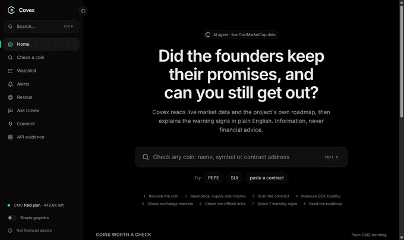
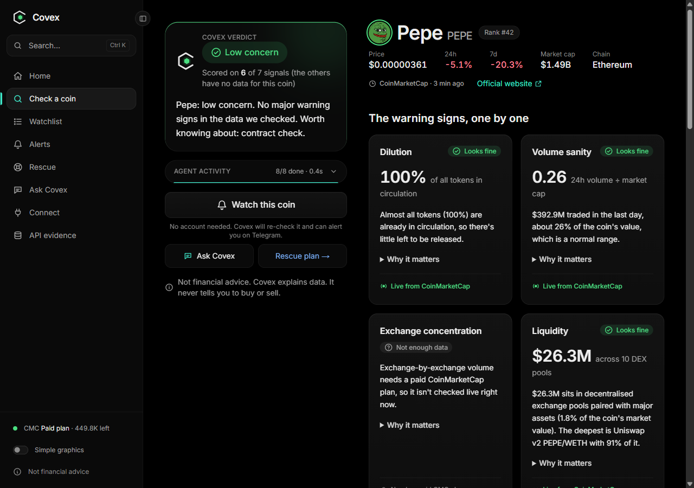
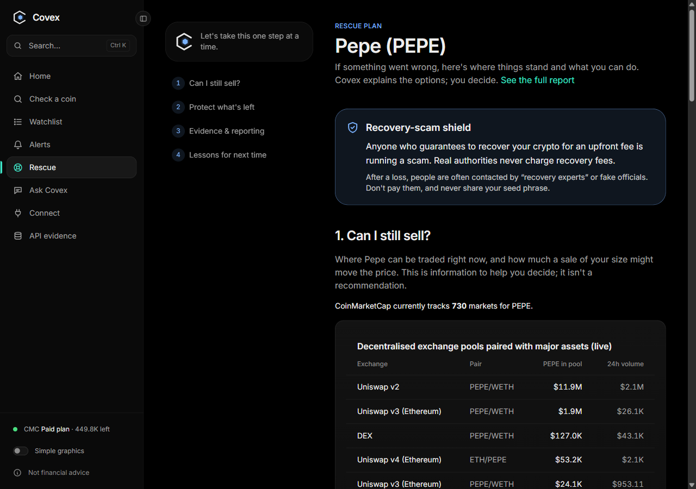
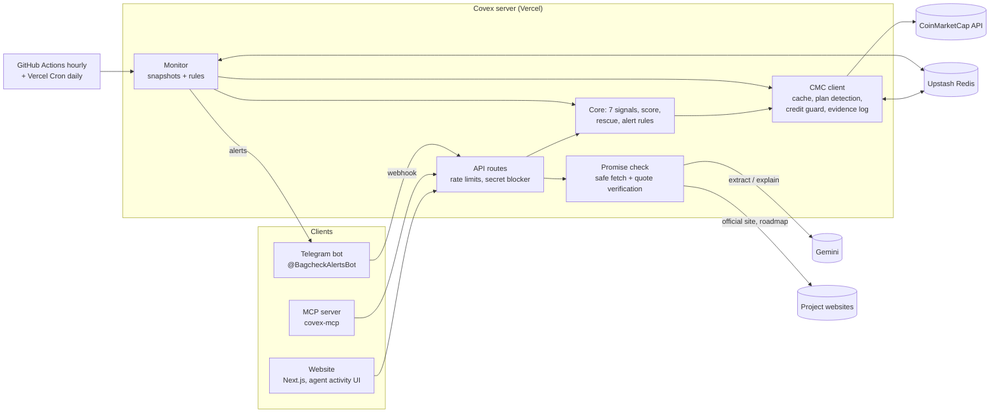

# Covex

[](https://github.com/Terhemba10/covex/actions/workflows/ci.yml)

**Did the founders keep their promises, and can you still get out?**

Covex is an AI agent for crypto holders, built on the [CoinMarketCap API](https://coinmarketcap.com/api/) for the *Build with CMC: API Hackathon* (AI Agents and Automation track).

> Not financial advice. Covex explains data. It never tells you to buy or sell.

## Try it in 30 seconds

**Live: https://covex-ai.vercel.app** (no sign-up, no wallet)

Open a report, watch Covex scan the coin, and read the warning signs one by one:

| Coin | What you'll see |
|---|---|
| [Bitcoin](https://covex-ai.vercel.app/coin/1) | A large, liquid coin: the baseline |
| [Pepe](https://covex-ai.vercel.app/coin/24478) | A meme coin: deep DEX liquidity, but the contract scan flags blacklist restrictions |
| [OFFICIAL TRUMP](https://covex-ai.vercel.app/coin/35336) | Medium concern: most of the supply is still to be released, and unusual volume |

Then try the [rescue plan for Pepe](https://covex-ai.vercel.app/rescue/24478), or message the Covex bot, [@BagcheckAlertsBot](https://t.me/BagcheckAlertsBot), on Telegram with `/check pepe` (Telegram usernames can't change, so it keeps the old handle).



## What it does

1. **Before you buy:** a plain-English risk report with 7 signals from live CMC data (dilution, volume sanity, exchange concentration, DEX liquidity, age and momentum, links health, contract check), plus a **Promise check** that reads the project's own website and roadmap and lists its dated promises, with quotes and sources.
2. **While you hold:** a watchlist that re-checks coins on a schedule and messages you on Telegram when a warning sign appears (falling volume, fewer markets, draining liquidity, a supply jump, the website going down, a promise date passing).
3. **If it went wrong:** a rescue plan: where the coin still trades, an estimated price impact for your amount, how to protect what's left, an evidence summary built in your browser, where to report, and a recovery-scam shield.

| Report | Rescue plan |
|---|---|
|  |  |

**Code decides, AI explains.** Scores, thresholds and alerts are computed in TypeScript from CMC data. The LLM (Gemini) only extracts promises (code keeps a quote only if it appears word for word on the cited page) and explains answers in the Ask Covex chat (code rejects any advice or any number that isn't in the report).

## Architecture



All CMC calls go through one server-side client ([`lib/cmc/client.ts`](lib/cmc/client.ts)). The key never reaches the browser, the bot or the MCP server.

## CoinMarketCap endpoints

| Endpoint | Used for | On the free Basic plan |
|---|---|---|
| `GET /v1/cryptocurrency/map` | Search: name, symbol, slug or contract → CMC id (0 credits) | ✅ |
| `GET /v2/cryptocurrency/info` | Official website and roadmap links (for the Promise check), launch date, contract addresses | ✅ |
| `GET /v3/cryptocurrency/quotes/latest` | Price, volume (CEX/DEX split), market cap, supply, number of markets, 7/30-day change; one batched call per monitor run | ✅ |
| `GET /v3/cryptocurrency/listings/latest` | "Coins worth a check" on the home page (top 200, filtered by warning-sign rules) | ✅ |
| `GET /v1/dex/security/detail` | Contract check: honeypot, buy/sell tax, blacklist, mintable/freezable, flagged by the security vendor | ✅ |
| `GET /v1/dex/token/pools` | DEX liquidity (pools paired with major assets only), rescue price-impact estimate, the "liquidity draining" alert | ✅ |
| `GET /v1/key/info` | Credit governor and plan detection (0 credits) | ✅ |
| `GET /v2/cryptocurrency/market-pairs/latest` | Exchange concentration; centralised-exchange markets in the rescue plan | ❌ 1006 (detected at runtime, labelled in the UI) |
| `GET /v1/cryptocurrency/trending/gainers-losers` | "Coins worth a check" when the plan allows (falls back to listings) | ❌ 1006 |
| `GET /v2/cryptocurrency/price-performance-stats/latest` | Probed only; not used on Basic | ❌ 1006 |
| `GET /v1/global-metrics/quotes/latest`, `GET /v5/cryptocurrency/ohlcv/historical`, `GET /v1/dex/token-liquidity/query` | Probed by `/api/admin/probe` and documented in [`docs/ENDPOINTS.md`](docs/ENDPOINTS.md); the product compares with Bitcoin's quote and uses its own liquidity snapshots instead | ✅ / ✅ / 400 |

**Plan change (20 Nov 2026):** the key moved from Basic to a paid plan (450,000 credits/month). Trending and price-performance now answer live; market pairs still returns `1006`. Demo snapshots of the newly available data are in [`data/demo/`](data/demo/). Everything above still works on Basic.

Live status per endpoint, example responses and plan notes: [`docs/ENDPOINTS.md`](docs/ENDPOINTS.md). Real call log: [`docs/API_EVIDENCE.md`](docs/API_EVIDENCE.md) and the live [`/evidence`](https://covex-ai.vercel.app/evidence) page. What we ran into: [`docs/API_FEEDBACK.md`](docs/API_FEEDBACK.md).

### How it protects the key and the credits

- **Plan detection:** a `1006` response marks that endpoint as not in the plan for 24 h, and the UI says so instead of breaking. Every feature works on Basic first.
- **Credit governor and guard:** background monitoring adapts its schedule to the credits left ([`lib/cmc/budget.ts`](lib/cmc/budget.ts)); paid calls stop at a daily cap and a monthly reserve, read from `/v1/key/info` ([`lib/cmc/guard.ts`](lib/cmc/guard.ts)).
- **Caching** per endpoint (60 s to 24 h) plus a "last good copy" fallback; **per-IP rate limits** with hashed IPs ([`lib/ratelimit.ts`](lib/ratelimit.ts)).
- **Safety:** seed phrases and private keys are blocked in the browser, on the server, in the bot (the message is deleted) and in the MCP server; project pages are fetched through an SSRF-safe fetcher ([`lib/net/safeFetch.ts`](lib/net/safeFetch.ts)).

## Use it from an AI assistant (MCP)

[`mcp/`](mcp/) is a Model Context Protocol server with four tools: `check_token`, `promise_check`, `watch_token` and `rescue_plan`. It needs no API key (it calls Covex's public API with the same limits and rules) and runs with one command, with no clone or build. It needs Node.js 20 or newer.

Claude Code:

```bash
claude mcp add covex -- npx -y https://raw.githubusercontent.com/Terhemba10/covex/main/mcp/covex-mcp.tgz
```

Claude Desktop and other clients (MCP config file):

```json
{
  "mcpServers": {
    "covex": {
      "command": "npx",
      "args": ["-y", "https://raw.githubusercontent.com/Terhemba10/covex/main/mcp/covex-mcp.tgz"]
    }
  }
}
```

On Windows, Claude Desktop needs `"command": "cmd"` and `"args": ["/c", "npx", "-y", "https://raw.githubusercontent.com/Terhemba10/covex/main/mcp/covex-mcp.tgz"]`. Then ask: *"Check PEPE with Covex"* or *"I can't sell my token, what can I do?"* More in [`mcp/README.md`](mcp/README.md).

## Run it locally

```bash
npm install
cp .env.example .env.local   # add CMC_API_KEY (and optionally GEMINI_API_KEY, TELEGRAM_BOT_TOKEN)
npm run dev                  # http://localhost:3000
```

Without Upstash variables an in-memory store is used. All environment variables are documented in [`.env.example`](.env.example).

```bash
npm test                     # 280+ unit tests (fixtures, no API calls)
npx tsc --noEmit             # typecheck
npx eslint .                 # lint
npm run build                # production build
```

CI runs all four on every push, and checks that the committed MCP bundle matches its source ([`.github/workflows/ci.yml`](.github/workflows/ci.yml)).

## Tech

Next.js 16 (App Router) + TypeScript + Tailwind v4, Motion for UI animation (one tokens file, reduced-motion and "Simple graphics" aware; no WebGL), Upstash Redis, Google Gemini, the MCP TypeScript SDK, Vitest and Playwright. Design system: [`design/DESIGN_SPEC.md`](design/DESIGN_SPEC.md), live at [`/design`](https://covex-ai.vercel.app/design).

## Licence

MIT
